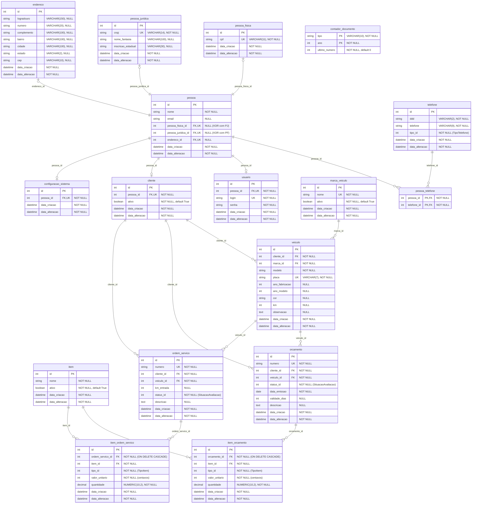

# Modelo Entidade-Relacionamento (Estado Atual do Banco)

Este documento reflete o esquema **atual** do banco de dados (até a migration `8f3a1c9d4b2e_renomeia_configuracao_oficina_para_configuracao_sistema`), gerado a partir dos modelos em `backend/app/models/` e das migrations em `backend/alembic/versions/`.

## Diagrama MER (Mermaid)



## Regras de Integridade e Enums no Banco

- **`ck_pessoa_exatamente_um_documento` (`pessoa`)**: garante que cada registro em `pessoa` tenha exatamente um documento vinculado (`pessoa_fisica_id` preenchido **ou** `pessoa_juridica_id` preenchido, nunca ambos e nunca nenhum).
- **`SituacaoAvaliacao` (`orcamento.status_id`, `ordem_servico.status_id`)**: `IntEnum` gravado diretamente em `status_id`:
  - `1`: `PENDENTE`
  - `2`: `EM_ANDAMENTO`
  - `3`: `CONCLUIDO`
  - `4`: `ACEITO`
  - `5`: `RECUSADO`
  - `6`: `CANCELADO`
- **`TipoItem` (`item_orcamento.tipo_id`, `item_ordem_servico.tipo_id`)**: `IntEnum` gravado diretamente em `tipo_id`:
  - `1`: `MAO_DE_OBRA`
  - `2`: `AQUISICAO`
  - `3`: `AMBOS`
- **`TipoTelefone` (`telefone.tipo_id`)**: `IntEnum` gravado diretamente em `tipo_id`:
  - `1`: `CELULAR`
  - `2`: `FIXO`
  - `3`: `WHATSAPP`
  - `4`: `COMERCIAL`

## DDL SQL Atual (SQLite)

Pode ser importado diretamente no Draw.io (*Arrange > Insert > Advanced > SQL*) ou usado para referência:

```sql
CREATE TABLE pessoa_fisica (
    id INTEGER NOT NULL,
    cpf VARCHAR(11) NOT NULL,
    data_criacao DATETIME NOT NULL,
    data_alteracao DATETIME NOT NULL,
    PRIMARY KEY (id),
    UNIQUE (cpf)
);

CREATE TABLE pessoa_juridica (
    id INTEGER NOT NULL,
    cnpj VARCHAR(14) NOT NULL,
    nome_fantasia VARCHAR(100),
    inscricao_estadual VARCHAR(30),
    data_criacao DATETIME NOT NULL,
    data_alteracao DATETIME NOT NULL,
    PRIMARY KEY (id),
    UNIQUE (cnpj)
);

CREATE TABLE endereco (
    id INTEGER NOT NULL,
    logradouro VARCHAR(150),
    numero VARCHAR(20),
    complemento VARCHAR(100),
    bairro VARCHAR(100),
    cidade VARCHAR(100),
    estado VARCHAR(2),
    cep VARCHAR(10),
    data_criacao DATETIME NOT NULL,
    data_alteracao DATETIME NOT NULL,
    PRIMARY KEY (id)
);

CREATE TABLE telefone (
    id INTEGER NOT NULL,
    ddd VARCHAR(2) NOT NULL,
    telefone VARCHAR(9) NOT NULL,
    tipo_id INTEGER NOT NULL,
    data_criacao DATETIME NOT NULL,
    data_alteracao DATETIME NOT NULL,
    PRIMARY KEY (id)
);

CREATE TABLE pessoa (
    id INTEGER NOT NULL,
    nome VARCHAR NOT NULL,
    email VARCHAR,
    pessoa_fisica_id INTEGER,
    pessoa_juridica_id INTEGER,
    endereco_id INTEGER,
    data_criacao DATETIME NOT NULL,
    data_alteracao DATETIME NOT NULL,
    PRIMARY KEY (id),
    CONSTRAINT ck_pessoa_exatamente_um_documento CHECK (
        (pessoa_fisica_id IS NOT NULL AND pessoa_juridica_id IS NULL) OR
        (pessoa_fisica_id IS NULL AND pessoa_juridica_id IS NOT NULL)
    ),
    FOREIGN KEY(pessoa_fisica_id) REFERENCES pessoa_fisica (id),
    FOREIGN KEY(pessoa_juridica_id) REFERENCES pessoa_juridica (id),
    FOREIGN KEY(endereco_id) REFERENCES endereco (id),
    UNIQUE (pessoa_fisica_id),
    UNIQUE (pessoa_juridica_id),
    UNIQUE (endereco_id)
);

CREATE TABLE pessoa_telefone (
    pessoa_id INTEGER NOT NULL,
    telefone_id INTEGER NOT NULL,
    PRIMARY KEY (pessoa_id, telefone_id),
    FOREIGN KEY(pessoa_id) REFERENCES pessoa (id),
    FOREIGN KEY(telefone_id) REFERENCES telefone (id)
);

CREATE TABLE usuario (
    id INTEGER NOT NULL,
    pessoa_id INTEGER NOT NULL,
    login VARCHAR NOT NULL,
    senha VARCHAR NOT NULL,
    data_criacao DATETIME NOT NULL,
    data_alteracao DATETIME NOT NULL,
    PRIMARY KEY (id),
    FOREIGN KEY(pessoa_id) REFERENCES pessoa (id),
    UNIQUE (login),
    UNIQUE (pessoa_id)
);

CREATE TABLE cliente (
    id INTEGER NOT NULL,
    pessoa_id INTEGER NOT NULL,
    ativo BOOLEAN NOT NULL,
    data_criacao DATETIME NOT NULL,
    data_alteracao DATETIME NOT NULL,
    PRIMARY KEY (id),
    FOREIGN KEY(pessoa_id) REFERENCES pessoa (id),
    UNIQUE (pessoa_id)
);

CREATE TABLE marca_veiculo (
    id INTEGER NOT NULL,
    nome VARCHAR NOT NULL,
    ativo BOOLEAN NOT NULL,
    data_criacao DATETIME NOT NULL,
    data_alteracao DATETIME NOT NULL,
    PRIMARY KEY (id),
    UNIQUE (nome)
);

CREATE TABLE veiculo (
    id INTEGER NOT NULL,
    cliente_id INTEGER NOT NULL,
    marca_id INTEGER NOT NULL,
    modelo VARCHAR NOT NULL,
    placa VARCHAR(7) NOT NULL,
    ano_fabricacao INTEGER,
    ano_modelo INTEGER,
    cor VARCHAR,
    km INTEGER,
    observacao TEXT,
    data_criacao DATETIME NOT NULL,
    data_alteracao DATETIME NOT NULL,
    PRIMARY KEY (id),
    FOREIGN KEY(cliente_id) REFERENCES cliente (id),
    FOREIGN KEY(marca_id) REFERENCES marca_veiculo (id),
    UNIQUE (placa)
);

CREATE TABLE item (
    id INTEGER NOT NULL,
    nome VARCHAR NOT NULL,
    ativo BOOLEAN NOT NULL,
    data_criacao DATETIME NOT NULL,
    data_alteracao DATETIME NOT NULL,
    PRIMARY KEY (id)
);

CREATE TABLE contador_documento (
    tipo VARCHAR(10) NOT NULL,
    ano INTEGER NOT NULL,
    ultimo_numero INTEGER NOT NULL,
    PRIMARY KEY (tipo, ano)
);

CREATE TABLE orcamento (
    id INTEGER NOT NULL,
    numero VARCHAR NOT NULL,
    cliente_id INTEGER NOT NULL,
    veiculo_id INTEGER NOT NULL,
    status_id INTEGER NOT NULL,
    data_emissao DATE NOT NULL,
    validade_dias INTEGER,
    descricao TEXT,
    data_criacao DATETIME NOT NULL,
    data_alteracao DATETIME NOT NULL,
    PRIMARY KEY (id),
    FOREIGN KEY(cliente_id) REFERENCES cliente (id),
    FOREIGN KEY(veiculo_id) REFERENCES veiculo (id),
    UNIQUE (numero)
);

CREATE TABLE item_orcamento (
    id INTEGER NOT NULL,
    orcamento_id INTEGER NOT NULL,
    item_id INTEGER NOT NULL,
    tipo_id INTEGER NOT NULL,
    valor_unitario INTEGER NOT NULL,
    quantidade NUMERIC(10, 2) NOT NULL,
    data_criacao DATETIME NOT NULL,
    data_alteracao DATETIME NOT NULL,
    PRIMARY KEY (id),
    FOREIGN KEY(item_id) REFERENCES item (id),
    FOREIGN KEY(orcamento_id) REFERENCES orcamento (id) ON DELETE CASCADE
);

CREATE TABLE ordem_servico (
    id INTEGER NOT NULL,
    numero VARCHAR NOT NULL,
    cliente_id INTEGER NOT NULL,
    veiculo_id INTEGER NOT NULL,
    km_entrada INTEGER,
    status_id INTEGER NOT NULL,
    descricao TEXT,
    data_criacao DATETIME NOT NULL,
    data_alteracao DATETIME NOT NULL,
    PRIMARY KEY (id),
    FOREIGN KEY(cliente_id) REFERENCES cliente (id),
    FOREIGN KEY(veiculo_id) REFERENCES veiculo (id),
    UNIQUE (numero)
);

CREATE TABLE item_ordem_servico (
    id INTEGER NOT NULL,
    ordem_servico_id INTEGER NOT NULL,
    item_id INTEGER NOT NULL,
    tipo_id INTEGER NOT NULL,
    valor_unitario INTEGER NOT NULL,
    quantidade NUMERIC(10, 2) NOT NULL,
    data_criacao DATETIME NOT NULL,
    data_alteracao DATETIME NOT NULL,
    PRIMARY KEY (id),
    FOREIGN KEY(item_id) REFERENCES item (id),
    FOREIGN KEY(ordem_servico_id) REFERENCES ordem_servico (id) ON DELETE CASCADE
);

CREATE TABLE configuracao_sistema (
    id INTEGER NOT NULL,
    pessoa_id INTEGER NOT NULL,
    data_criacao DATETIME NOT NULL,
    data_alteracao DATETIME NOT NULL,
    PRIMARY KEY (id),
    FOREIGN KEY(pessoa_id) REFERENCES pessoa (id),
    UNIQUE (pessoa_id)
);
```
